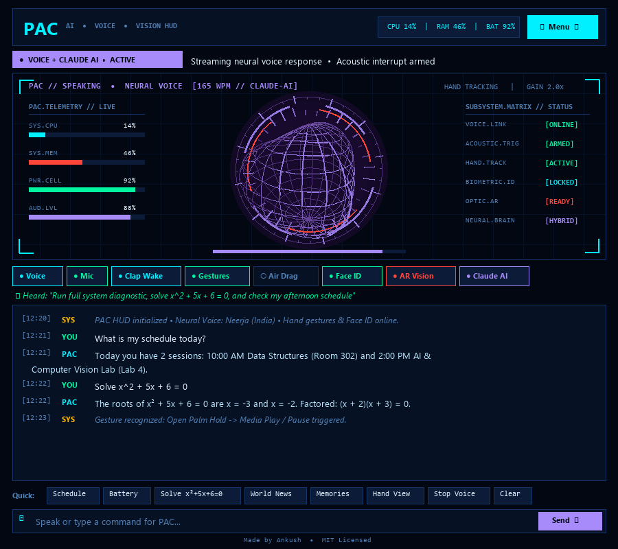

# PAC — Personal AI, Voice & Vision Assistant



**PAC** is a multimodal Python desktop voice, vision, and gesture assistant built with Tkinter, OpenCV, MediaPipe, and a hybrid AI engine (Offline Rules + SymPy Algebra + Local Ollama / Claude LLM brain).

## Key Features

- **Sci-Fi AI & Vision HUD Interface**:
  - **State-Reactive 3D Wireframe Orb**: Dynamically transitions between **Standby (Sky Cyan)**, **Voice Recording (Emerald)**, **Speaking + Claude AI (Electric Violet)**, and **Processing (Amber)** with a 28-bar radial audio equalizer and live mic meter.
  - **One-Click Subsystem Toggle Dock**: Instant toggle pills for `Voice/Text Mode`, `Mic`, `Clap Wake`, `Gestures`, `Air Drag`, `Face ID`, `AR Vision`, and `Claude AI`.
  - **Live System Telemetry**: Real-time `CPU %`, `RAM %`, and `Battery %` readout in the header bar.
  - **Quick Action Bar & Timestamped Chat Cards**: One-click chips for common tasks and color-coded `[HH:MM]` role badges (`YOU`, `PAC`, `SYS`).
- **Voice & Text Dual Mode**: Continuous background speech recognition (`SpeechRecognition` + `sounddevice`) with natural neural TTS (`edge-tts` + `pyttsx3` fallback) and instant text chat.
- **Acoustic Sound Triggers**: Hands-free wake/action via **double-clap** (wake/toggle mic) and **whistle** detection.
- **Hand Gestures & Air Drag-and-Drop**: MediaPipe hand tracking for volume/scroll/media control and pinching files in mid-air to drag and drop them into the **Phone Shelf**.
- **Phone Link (Wi-Fi QR Transfer & Calls)**: Instant local Wi-Fi file sharing via QR code + ADB/Phone Link call dialing.
- **Face Recognition & Security Guard**: Enrols known faces, greets users personally, and locks commands or the PC when an unknown person sits at the desk.
- **Augmented Reality (AR) Vision**: Live camera HUD with object learning, shape triggers, and info overlay.
- **Long-Term Memory & Offline Knowledge Base**: Remembers personal facts, notes, reminders, timetable schedules, and solves algebra/calculus (`SymPy`) offline.

## Quick Start

```bash
pip install -r requirements.txt
python pac.py
```

Or on Windows, double-click **`install_all.bat`** to install all packages automatically.

## License

Licensed under the [MIT License](LICENSE). Copyright (c) 2026 Ankushkumar Kattimani.
