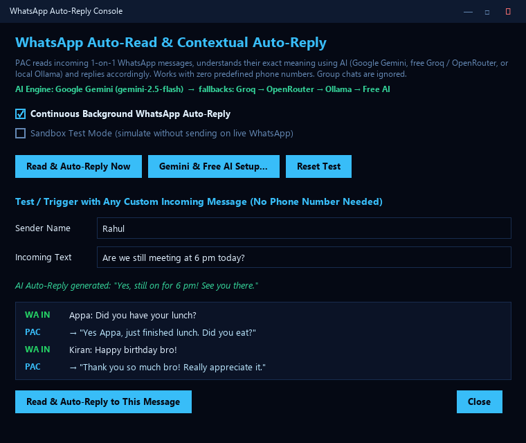
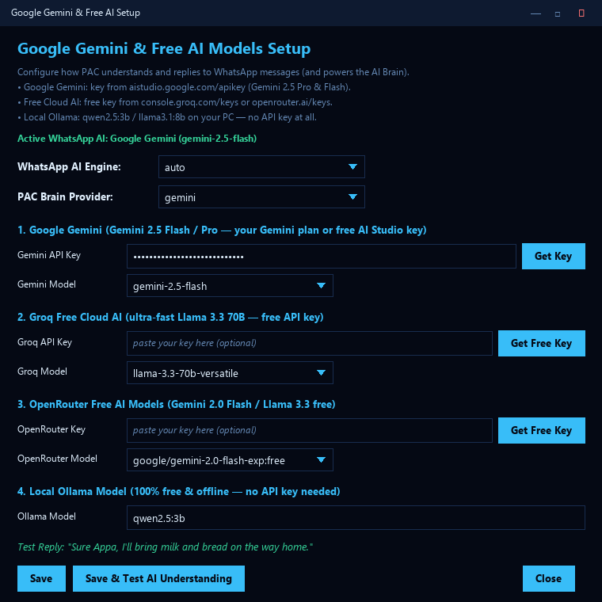

# PAC — Personal AI, Voice & Vision Assistant


**PAC** is a multimodal Python desktop voice, vision, and gesture assistant built with Tkinter, OpenCV, MediaPipe, and a hybrid AI engine (Offline Rules + SymPy Algebra + Google Gemini / Groq / OpenRouter / Local Ollama / Claude LLM brain).

## NEW: WhatsApp AI Auto-Reply

PAC reads incoming 1-on-1 WhatsApp messages, **understands what was actually said** using AI, and **automatically replies** on WhatsApp Desktop with a contextual answer.

| WhatsApp Auto-Reply Console | Google Gemini & Free AI Setup |
| :---: | :---: |
|  |  |

- **Reads every new message**: picks up incoming messages from Windows notifications and WhatsApp Desktop's local store, including photos, voice notes, documents and stickers.
- **Understands & replies accordingly**: "Bring milk and bread while coming home" → *"Sure, I'll pick up milk and bread on the way."* — no more generic "hello" replies to everything.
- **Per-chat conversation memory** so follow-up messages get sensible replies.
- **Zero predefined phone numbers**: replies by chat name; nothing is hard-coded.
- **Group chats are never auto-replied.**
- **Choose your AI engine** (automatic fallback chain):
  1. **Google Gemini** — `gemini-2.5-flash`, `gemini-2.5-pro`, `gemini-2.0-flash` (your Gemini plan or a free [AI Studio key](https://aistudio.google.com/apikey))
  2. **Groq** (free) — `llama-3.3-70b-versatile` ([free key](https://console.groq.com/keys))
  3. **OpenRouter** (free models) — `google/gemini-2.0-flash-exp:free` ([free key](https://openrouter.ai/keys))
  4. **Local Ollama** — `qwen2.5:3b` / `llama3.1:8b`, fully offline, **no key needed**
  5. **Claude** (optional) and a **no-key free cloud AI** fallback

**Set it up:** `Menu → Contacts and messages → Google Gemini & Free AI Setup...`, or just say/type:

```
gemini setup                    open the API key & model window
use gemini for whatsapp         pick the WhatsApp reply engine (gemini / groq / openrouter / ollama / free / auto)
use gemini as brain             use Gemini for PAC's main AI brain
ask gemini <question>           one-off question to Gemini
whatsapp auto reply on / off    toggle background auto-reply
```

> **API keys are never stored in this repository.** Paste them in the setup window (kept in your OS credential store / local config) or use environment variables — see [`.env.example`](.env.example).

## Key Features

- **Sci-Fi AI & Vision HUD Interface**:
  - **State-Reactive 3D Wireframe Orb**: Dynamically transitions between **Standby (Sky Cyan)**, **Voice Recording (Emerald)**, **Speaking + AI (Electric Violet)**, and **Processing (Amber)** with a 28-bar radial audio equalizer and live mic meter.
  - **One-Click Subsystem Toggle Dock**: Instant toggle pills for `Voice/Text Mode`, `Mic`, `Clap Wake`, `Gestures`, `Air Drag`, `Face ID`, `AR Vision`, `WA Auto-Reply`, and `Claude AI`.
  - **Live System Telemetry**: Real-time `CPU %`, `RAM %`, and `Battery %` readout in the header bar.
  - **Quick Action Bar & Timestamped Chat Cards**: One-click chips for common tasks and color-coded `[HH:MM]` role badges (`YOU`, `PAC`, `SYS`).
- **WhatsApp AI Auto-Reply**: Auto-reads and contextually replies to WhatsApp messages using Google Gemini, free Groq/OpenRouter models, or local Ollama (see above).
- **Voice & Text Dual Mode**: Continuous background speech recognition (`SpeechRecognition` + `sounddevice`) with natural neural TTS (`edge-tts` + `pyttsx3` fallback) and instant text chat.
- **Acoustic Sound Triggers**: Hands-free wake/action via **double-clap** (wake/toggle mic) and **whistle** detection.
- **Hand Gestures & Air Drag-and-Drop**: MediaPipe hand tracking for volume/scroll/media control and pinching files in mid-air to drag and drop them into the **Phone Shelf**.
- **Phone Link (Wi-Fi QR Transfer & Calls)**: Instant local Wi-Fi file sharing via QR code + ADB/Phone Link call dialing.
- **Face Recognition & Security Guard**: Enrols known faces, greets users personally, and locks commands or the PC when an unknown person sits at the desk.
- **Augmented Reality (AR) Vision**: Live camera HUD with object learning, shape triggers, and info overlay.
- **Long-Term Memory & Offline Knowledge Base**: Remembers personal facts, notes, reminders, timetable schedules, and solves algebra/calculus (`SymPy`) offline.

## Quick Start

```bash
pip install -r requirements.txt
python pac.py
```

Or on Windows, double-click **`install_all.bat`** to install all packages automatically.

For WhatsApp Auto-Reply, keep **WhatsApp Desktop** signed in and allow its Windows notifications. Optionally add an AI key via `gemini setup`, or run [Ollama](https://ollama.com) with `ollama pull qwen2.5:3b` for a fully offline, key-free setup.

## License

Licensed under the [MIT License](LICENSE). Copyright (c) 2026 Ankushkumar Kattimani.
